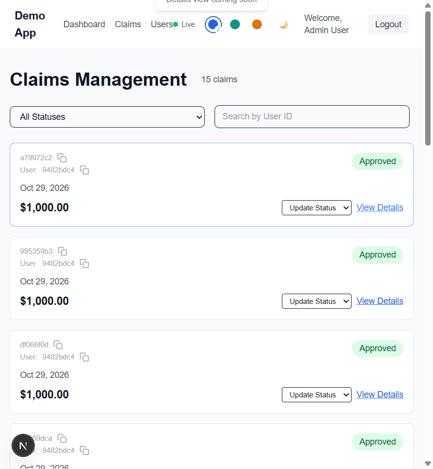
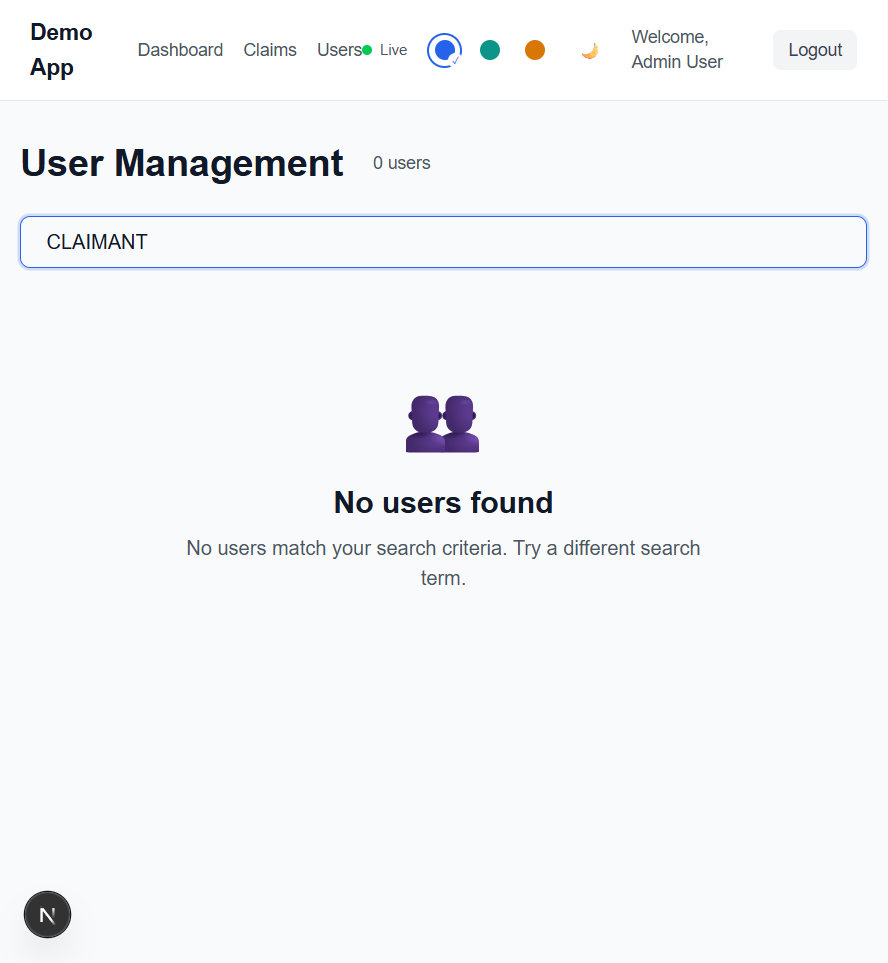
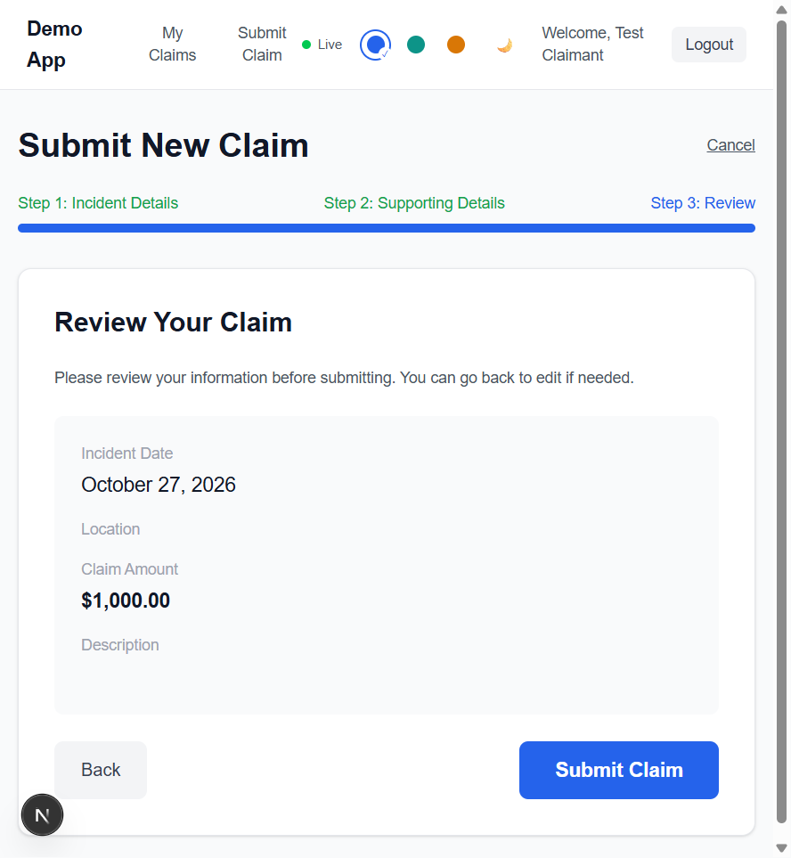
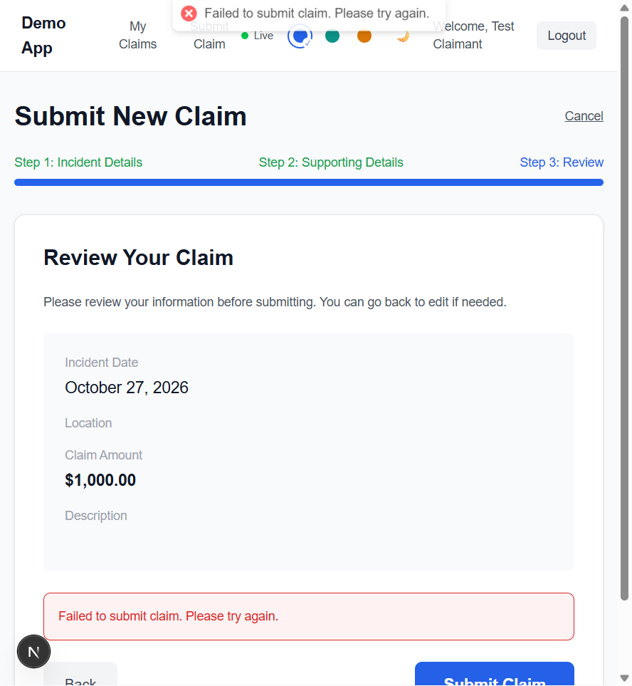
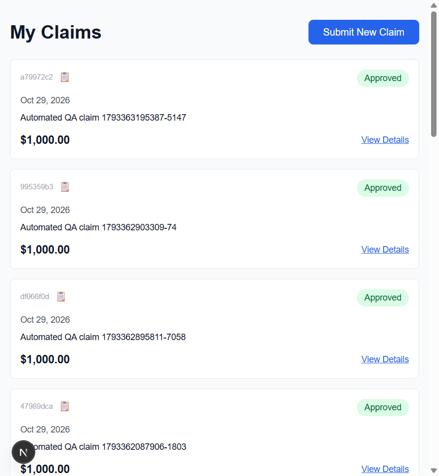

# UI Defects

Exploratory UI review performed on 2026-10-30 against `http://localhost:3001`.
Findings below were reproduced in a browser while signed in with the relevant role.
Screenshot evidence was captured on 2026-10-31 and is stored under `evidence/`.

## DEFECT-UI-001: Admin claim details action is a placeholder

- **Role:** Admin
- **Severity:** Medium (P2)
- **Area:** Claims Management
- **Steps to reproduce:**
  1. Sign in as an admin.
  2. Open **Claims**.
  3. Click **View Details** on any claim.
- **Expected:** The selected claim's details open so the admin can review its full information.
- **Actual:** The page only displays a toast saying **Details view coming soon**. No claim details are shown.
- **Evidence:** Reproduced on the admin claims list; both desktop table and mobile card actions use the same placeholder behavior.

## DEFECT-UI-002: User search does not ignore surrounding whitespace

- **Role:** Admin
- **Severity:** Low (P3)
- **Area:** User Management search
- **Steps to reproduce:**
  1. Sign in as an admin and open **Users**.
  2. Search for `CLAIMANT`; verify the claimant appears.
  3. Search for ` CLAIMANT ` with a leading and trailing space.
- **Expected:** The same claimant remains in the results because the search term contains the same text.
- **Actual:** The page shows **0 users** and **No users found**.
- **Evidence:** Reproduced in the UI. The search compares the raw input against lowercased user fields without trimming it.

## DEFECT-UI-003: Whitespace-only claim details pass required-field validation

- **Role:** Claimant
- **Severity:** Medium (P2)
- **Area:** New Claim wizard
- **Steps to reproduce:**
  1. Sign in as a claimant and open **Submit New Claim**.
  2. Enter a valid incident date, five spaces for the location, and a valid amount.
  3. Click **Next**, enter ten spaces for the description, and click **Next** again.
- **Expected:** The wizard rejects blank-looking required values and keeps the claimant on the relevant step with a validation message.
- **Actual:** Both steps accept the whitespace-only values. The Review page displays blank location and description values while **Submit Claim** remains enabled.
- **Evidence:** Reproduced through the UI. The invalid values advanced to Review; a separate submission attempt confirmed the service rejects them and persists no claim.

## DEFECT-UI-004: Claim validation errors surface as server failures

- **Role:** Claimant
- **Severity:** Low (P3)
- **Area:** Claim submission error handling
- **Steps to reproduce:**
  1. Sign in as a claimant and open **Submit New Claim**.
  2. Enter valid date and amount values, but use whitespace-only required text values that pass the UI validation.
  3. Submit the claim from the Review step.
- **Expected:** A validation response is handled as a client input error, with a clear message identifying the invalid fields.
- **Actual:** The Claims Service rejects the request with HTTP 400, but the BFF turns it into HTTP 500 and the UI displays only **Failed to submit claim. Please try again.**
- **Evidence:** Reproduced in browser; backend logs show the validation 400 from Claims Service followed by an unhandled BFF exception. No claim was persisted.

## DEFECT-UI-005: Claimant records remain visible after logout

- **Role:** Claimant
- **Severity:** High (P1)
- **Area:** Logout and protected routes
- **Steps to reproduce:**
  1. Sign in as a claimant and open **My Claims**.
  2. Click **Logout** and confirm the browser returns to **Log In**.
  3. Navigate directly to `http://localhost:3001/claims`.
- **Expected:** The protected route redirects to **Log In** and does not display claimant records.
- **Actual:** The route loads the claimant's claims, including IDs, descriptions, statuses, and amounts, while the authenticated header is absent.
- **Evidence:** Reproduced after logout, both with browser Back and by navigating from Login directly to `/claims`. This finding records the UI behavior; the underlying cookie/session cause has not been isolated.

## Checks That Passed

- Claimant claim details opened and displayed the full claim ID, status, incident information, and timestamps.
- Claim submission UI blocked a claim amount above the displayed $1,000,000 maximum.
- Admin user search matched `CLAIMANT` without surrounding spaces and displayed the empty state for unmatched text.
- Admin status selector exposed only allowed next statuses for approved claims.